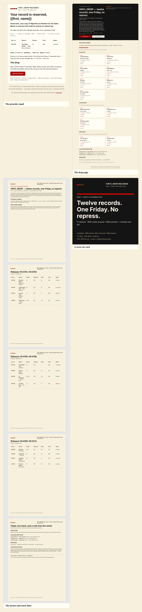
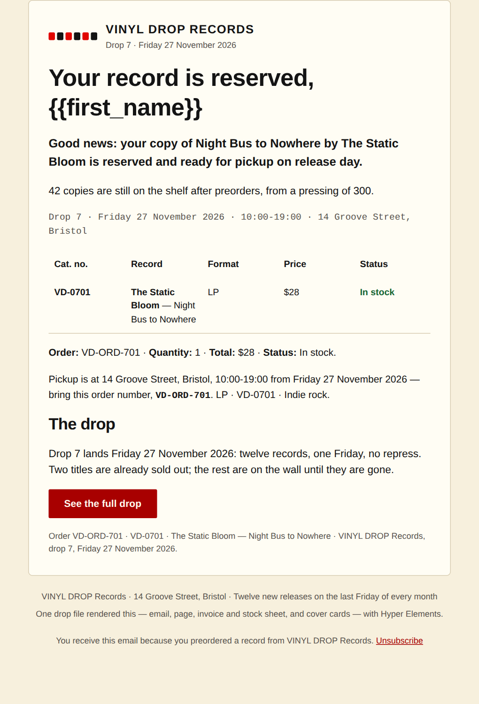
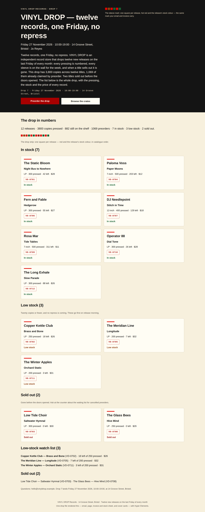
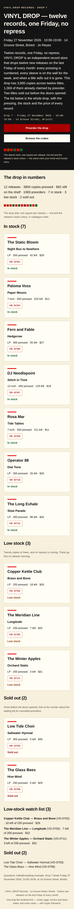
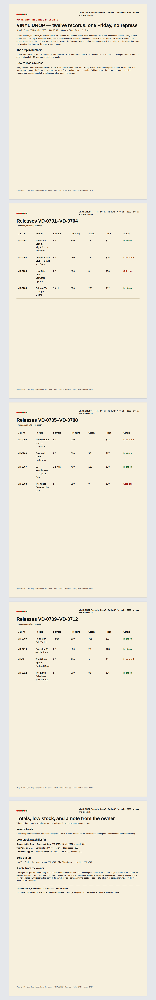
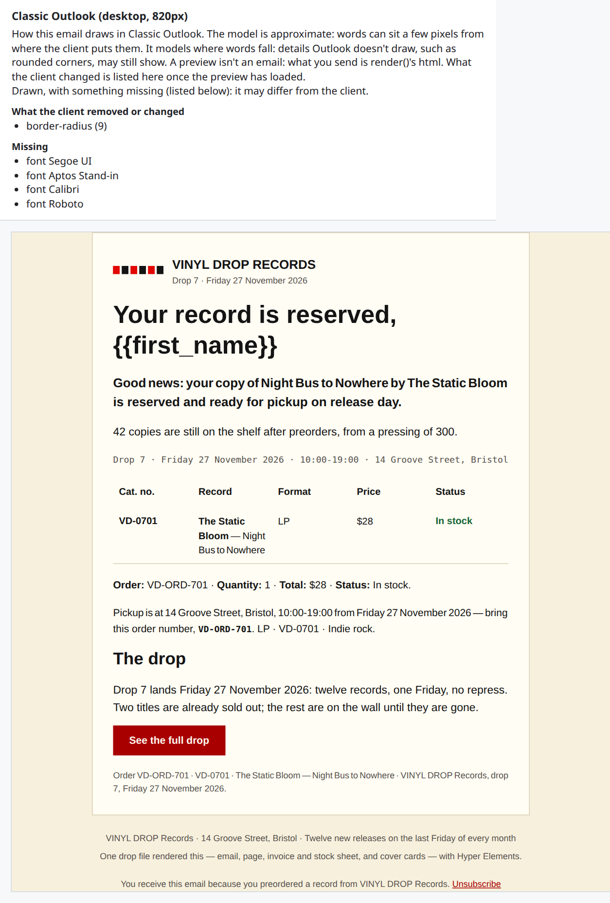
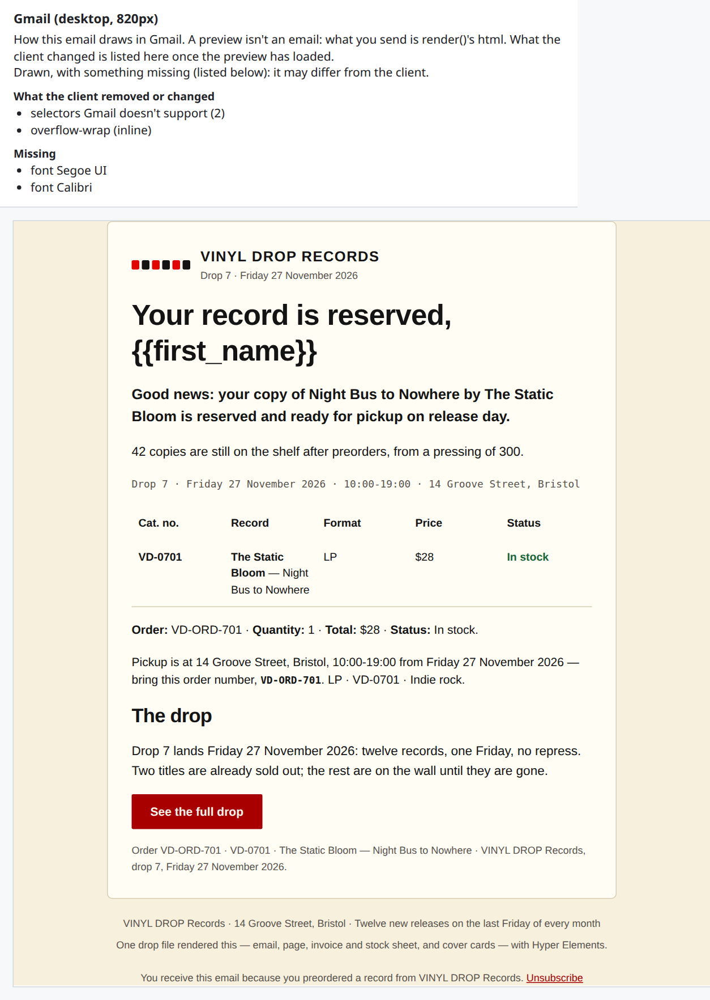

# VINYL DROP — Twelve records, one Friday, no repress

A Hyper Elements template kit for an independent record store's
monthly release drop. **One drop file** (`src/data/drop.ts`) renders
everything a release drop needs — the preorder email, the public
drop page, the printed invoice and stock sheet as a real PDF, and
the square cover-art cards — from **one theme** and **one set of
shared components**.



*Every screenshot in this README is a photograph of a real render
(`npm run render` + `npm run shots`): if it is pictured, it was rendered.*

**Measured on the demo run (22 Nov 2026):** one drop file → **12
personalised preorder emails**, a **5-page invoice and stock-sheet
PDF** (one A4 PDF: drop cover, three release pages, totals and the
owner's note), **13 cover-art cards** (drop cover + one per release)
— gate at **0 errors, 0 warnings**, batch in **2.3s**. Reproduce it:
`npm run check && npm run make`, then read `out/checks.json` and
`out/batch.json`.

| The email (600px) | The page (desktop) | The page (mobile) |
|---|---|---|
|  |  |  |

| The invoice and stock sheet (A4) | The email in Outlook | The email in Gmail |
|---|---|---|
|  |  |  |

The cover card PNG itself is in
[`examples/cover-card.png`](examples/cover-card.png).

## Why a record drop?

A release drop's paperwork fails in a predictable way: the email
says one thing, the wall sheet another, and the sleeve in the
customer's hand says a third — a different pressing, a different
price, a catalogue number spelled two ways. This kit makes that
impossible by construction. Every catalogue number, pressing and
price lives in **one drop file**; the email quotes it, the page's
cards carry it, and the printed invoice prints it next to the
owner's note. The **DropStrip** — one square per release, hot red
and the release's stock colour — is the drop drawn as a sleeve
spine, and it is built from `Row`s of fixed-width `Column`s so it
survives in an inbox that blocks images and in a PDF that never
loads one.

## The four outputs

| Output | Root | Script | What it is |
|---|---|---|---|
| Preorder email | `Email` → `render()` | `templates/preorder-email.tsx` | The news leads — your copy is reserved for pickup or shipping, with the pressing scarcity, the order total and the catalogue stamp, a MergeTag greeting, plain-text twin from the same render |
| Drop page | `Page` → `render()` | `templates/store-page.tsx` | Black hero, the twelve-release drop strip, every release as a typed `vinyl.ReleaseCard` grouped by stock status, low-stock watch list, phone styles, no client-side JavaScript |
| Invoice and stock sheet | `Document` → `renderPdf()` | `templates/invoice-document.tsx` | Five A4 pages — the drop (numbers, how to read a release), twelve releases four to a page, invoice totals, low-stock watch list and the owner's note, `PageHeader`/`PageFooter` with `PageNumber` |
| Cover cards | `Canvas` → `renderImage()` | `templates/cover-card.tsx` | 1080×1080 PNGs — the drop cover, plus one card per release with artist, title, blurb and pressing numbers in poster type |

## Run it

```bash
npm install
npm run check        # validate() gate: core + lint + email-clients -> out/checks.json
npm run render       # one of each output -> out/
npm run clients      # the email as Outlook / Gmail / Apple Mail draw it -> out/clients/
npm run make         # 12 preorder emails + invoice PDF + 13 cover cards -> out/preorders/, out/batch.json
npm run make:sample  # 4 emails, for a quick look
npm run shots        # screenshots of the real outputs -> docs/
```

Node 20+. `examples/` holds one artefact of each kind.

## The drop

VINYL DROP Records, Drop 7 — Friday 27 November 2026,
10:00-19:00, 14 Groove Street, Bristol. Twelve releases, 3,800
copies pressed, 882 still on the shelf, 1,069 preorders: 7 in stock,
3 low stock, 2 sold out, $28,403 in preorders, $14,641 of stock on
the shelf. The data file is the whole product: change the releases,
the preorders or the drop, and every output follows, because every
output reads the same file.

## Design

Bold retro: black `#141414`, cream paper `#f7f0dd`, hot red
`#e10600` for shapes only, dark red `#a80000` for text accents,
mono catalogue numbers. Status colours are dark enough to be text:
in stock green `#166534`, low stock amber `#92400e`, sold out red
`#991b1b`. See [`docs/design.md`](docs/design.md) for the notes and
the build lessons, including the one that cost a page: a Document
page clips what does not fit, it never flows it on.
